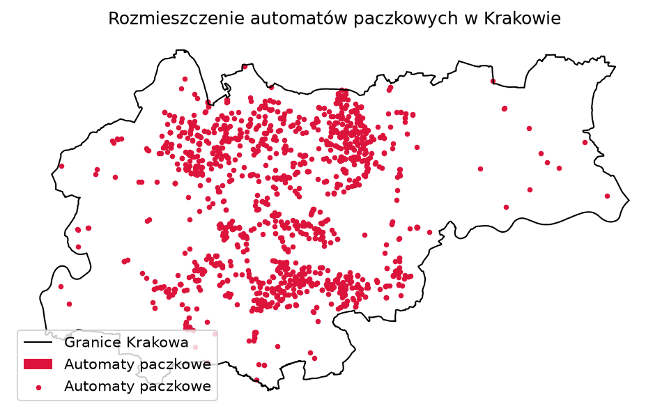

# Karta projektu

Wersja: [1 po P1 / 2 po P2] · Data: 2026-11-26

| Pole | Wasza odpowiedź |
| --- | --- |
| Zespół (imiona, loginy GitHub) | Mateusz Woźniak mwozniak2180, Jakub Wrzosek j-wrzosek |
| Temat (numer z listy albo własny) | Optymalizacja lokalizacji automatów paczkowych z wykorzystaniem grafowych sieci neuronowych (GNN). |
| Pytanie i odbiorca | Gdzie w Krakowie zlokalizować nowe automaty paczkowe?; Firma zajmująca się dostawami|
| Obszar i jednostka analizy | Kraków |
| Zmienna celu i źródło etykiet | Obecność automatu paczkowego w komórce H3 (0/1); OpenStreetMap (amenity=parcel_locker).|
| Dane: źródła, okres, format, licencja, dostęp | Overture Maps (Buildings, Places, Transportation) – GeoParquet; OpenStreetMap – GeoJSON, ODbL 1.0. Dane aktualne na 26.11.2026r |
| Cechy (wstępna lista) | Liczba budynków, powierzchnia zabudowy, liczba sklepów i punktów usługowych, długość dróg, dostępność komunikacyjna. |
| Model bazowy i model AI | Regresja logistyczna oraz grafowa sieć neuronowa GraphSAGE. |
| Miara sukcesu | Wyższa wartość PR-AUC modelu GNN względem modelu bazowego. |
| Walidacja: jak dzielicie dane i dlaczego | Podział przestrzenny 60/20/20 (trening, walidacja, test), ograniczy to wyciek danych. Uzupełnienie braku danych przed podziałem na zbiory. |
| Produkt GIS: warstwa i mapa | Warstwa GeoPackage w EPSG:2180 zawierająca komórki H3 z oceną potencjału lokalizacyjnego. Mapa rekomendowanych lokalizacji automatów paczkowych.|
| Ryzyka i plan B | Niekompletność danych, niezbalansowane klasy, brak danych o rzeczywistym popycie Plan B: wykorzystanie wyłącznie danych OSM oraz uproszczenie zestawu cech. |

## Szybki test danych (P1)

| Cecha | Wartość |
| --- | --- |
| Źródło | osm {'amenity': 'parcel_locker'} |
| Liczba rekordów | 1 525 |
| Typy geometrii | Point: 1435, Polygon: 90 |
| Rekordy bez geometrii | 0 |
| Układ współrzędnych pliku | EPSG:4326 |
| W obszarze projektu | 100% |
| Liczba kolumn | 82 |
| Kolumny z brakami [%] | access: 100, direction: 100, currency:PLN: 100, brand:wikipedia: 100, operator:type: 100, artwork_subject: 100 |

